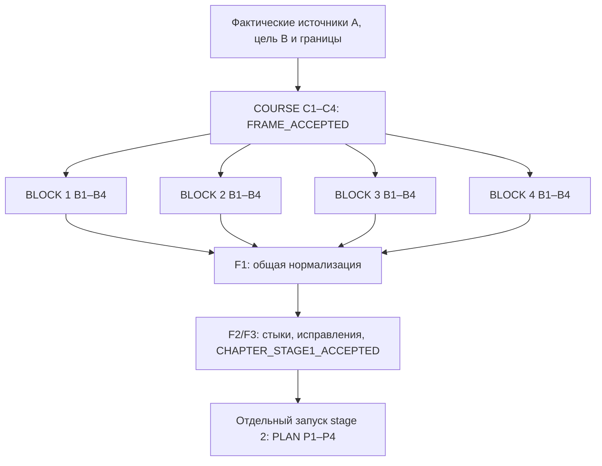

# Stage 1: архитектура методик главы и четырёх блоков

**Статус:** `PROPOSED / DOCUMENT_REVIEW_ONLY` · **Дата:** 25.10.2026 · **Eval:** `NOT_RUN`.

Это решение о будущем составе инструкций, а не новые инструкции и не запуск разработки глав, блоков, PLAN или уроков. Область изменения текущего запуска — только этот файл. Канонические [COURSE](../../make%20les%20stage/1%20stage/COURSE_CONCEPT_GUIDE.md), [BLOCK](../../make%20les%20stage/1%20stage/BLOCK_CONCEPT_GUIDE.md), [README stage 1](../../make%20les%20stage/1%20stage/README.md) и действующие учебные концепты сохраняются. Базовые версии трёх файлов архивированы; контрольные SHA-256 приведены в [baseline.json](baseline.json).

## Решение: ровно три рабочие методички

| Методичка (предлагаемый канонический файл) | Единица работы и назначение | Почему эта граница |
| --- | --- | --- |
| **1. `COURSE_CONCEPT_GUIDE.md`** (сохранить имя; развить существующий файл) | **Одна глава либо крупная часть курса:** A→B главы, четыре контракта блоков и принятая общая рамка. | Действующая COURSE уже проектирует курс **или крупную часть**, а не обязательно весь курс. Отдельный документ «CHAPTER» продублировал бы цели и создал две конкурирующие карты. |
| **2. `BLOCK_CONCEPT_GUIDE.md`** (сохранить имя; развить существующий файл) | **Один блок** с пятью основными учебными днями, обязательными подзанятиями и всеми паспортами; **одна и та же последовательность применяется ровно четыре раза** для четырёх разных BLOCK-файлов главы. | Дизайн карт и паспортов имеет одного владельца файла и связанный предметный маршрут. Раздельные методички «карта», «паспорт», «практика» привели бы к частичным концептам, повторным входам и разрыву между B занятия и проверкой. |
| **3. `CHAPTER_STITCH_ACCEPTANCE_GUIDE.md`** (**добавить впоследствии**, в `docs/make les stage/1 stage/`) | **Одна глава, четыре готовых проекта блоков:** сначала нормализация их контрактов, затем проверка всех стыков и выпуск полного набора в stage 2. | Совместная проверка зависит от всех четырёх файлов и не принадлежит ни одному block-дизайнеру. Отдельная методичка «нормализации» не нужна: это **первый обязательный проход** финальной приёмки, а не четвёртый независимый результат. |

Итого: **три определения процесса, шесть предметных проходов/запусков на главу**: один COURSE, четыре повторения одного BLOCK, одна совместная приёмка. Внутренние проверки не создают дополнительных методичек, чатов или статусов стадии. Существующие имена первых двух сохраняют рабочие ссылки; третье имя однозначно описывает новую обязанность.

## Точные контракты и владельцы

| Методичка | Вход | Сохранённый выход | Владелец записи | Готовность / gate |
| --- | --- | --- | --- | --- |
| **COURSE** | Цель и границы главы, аудитория и входные требования, действующий маршрут, источники фактического прохождения, актуальный срез проекта, целевая B и ограничения, четыре позиции блоков. При продолжении — граница предыдущей главы с доказательствами, а не только её план. | Один `docs/concept/chapter_<id>/COURSE.md` (либо уже установленный канонический путь): A со статусами, проверяемая B, единая карта **ровно четырёх** блоков и интерфейсы их переходов, общие правила нумерации/проекта, открытые предпосылки и способы их закрытия. | Оркестратор / ответственный методист главы; COURSE имеет одного редактора. | **`FRAME_ACCEPTED`**: A и B различают подтверждённое и планируемое; для каждого блока зафиксированы роль, ожидаемые A/B, темы, исключения, проверяемый продукт и граница с соседом; путь ацикличен, до обязательного действия можно подготовить нужные знания. Критичная неподготовленная предпосылка или спорная цель оставляет затронутую часть `FRAME_PARTIAL`. |
| **BLOCK × 4** | Принятая строка общей рамки, COURSE целиком, источники относящейся к блоку A, действующий BLOCK при переработке, реально доступные материалы/проект; соседние BLOCK при наличии **как свидетельства**, не как требование начать. | Ровно по одному `docs/concept/chapter_<id>/BLOCK_<номер>.md`: маршрут ровно пяти основных дней с обязательными подзанятиями, карта всех занятий, **семь заполненных полей паспорта каждого занятия**, конкретные самостоятельные действия и критерии, источник/статус A, B каждого шага, таблица номеров/старых ID при переносе, предложения зависимых правок без их выполнения. | Отдельный дизайнер `BLOCK_i`, **единственный писатель своего файла**. Каждый повторяет одну и ту же методичку полностью. | **`BLOCK_LOCAL_READY`**: документ проверен относительно зафиксированной рамки и собственных паспортов, будущий B предыдущего блока указан как **планируемый** с источником, точкой подготовки и условием проверки; практика доступна после объяснения; все семь полей заполнены; путь к следующему зафиксирован. Это кандидат для общей приёмки, **ещё не** окончательная готовность главы. |
| **CHAPTER_STITCH_ACCEPTANCE** | `FRAME_ACCEPTED` и **четыре `BLOCK_LOCAL_READY`** плюс актуальные источники, diff и перечень конфликтов/неподтверждённых опор. | Адресно исправленные **те же** четыре BLOCK, при необходимости согласованная корректировка единственного COURSE, и краткий **раздел итоговой приёмки в COURSE**: матрица переходов, полнота паспортов, открытые фактические проверки и точные входы для отдельно запускаемого stage 2. Дополнительные альтернативные концепты не создаются. | Оркестратор / межблочный интегратор; запись в COURSE — только у него, исправление конкретного BLOCK — у исходного владельца либо у назначенного единственного редактора. | **`CHAPTER_STAGE1_ACCEPTED`** только когда четыре блока нормализованы, локальная проверка перепройдена после правок, все переходы согласованы, нет обязательного неподготовленного умения и сформирована полная опись занятий. Иначе `CHAPTER_STAGE1_INCOMPLETE` с точным блокером/владельцем; stage 2 не объявляется запущенным. |

**Обязательные паспортные нормы, переходящие без ослабления.** Каждое занятие (в том числе обязательное подзанятие) содержит: (1) тему и назначение, (2) A с происхождением и статусом, (3) B, (4) темы с порядком введения, (5) конкретную основную практику, (6) выход и переход, (7) обоснованный диапазон **видимого текста теории** в словах. Для **нового** паспорта поле 7 обязательно. Диапазон, включая обоснованный диапазон ниже общего ориентира, переносится далее без повторного согласования; отсутствие диапазона допускает явно маркированный fallback лишь для **достоверно установленного legacy-паспорта**, а не для любого неполного нового. Основная практика не превращается в готовое решение или PLAN. Автопроверяемый обязательный формат сохраняется. Пять **основных учебных дней**, не пять календарных суток и не верхний предел пяти занятий; обязательные подзанятия входят в маршрут. Отображаемые номера — строковые, порядок `(день, подномер)`, номера дней сквозные по курсу; прежние публичные ID, алиасы и прогресс не меняются в концепте. Миграции передаются отдельно.

## Внутренние проходы, но не отдельные методички

**COURSE (одна глава):** `C1` восстановить доказательную A, ограничения и целевую B → `C2` разложить промежуточные наблюдаемые результаты и предпосылки на четыре блока → `C3` закрепить интерфейсы блоков (планируемые A/B, неизменяемые границы, проект, проверки) → `C4` проверить рамку вперёд и назад и принять `FRAME_ACCEPTED`. COURSE проектирует главу, при ином поручении сохраняет способность проектировать курс/крупную часть; она не требует готовых паспортов и не пишет PLAN.

**BLOCK (один и тот же маршрут ровно четыре раза):** `B1` восстановить A выбранного блока и проверить его договор с COURSE → `B2` создать граф занятий и распределить по пяти основным дням/подзанятиям → `B3` оформить каждый из семи пунктов всех паспортов, покрыть самостоятельную практику теорией и промежуточной практикой → `B4` проверить полноту B, переходы занятий, нумерацию, влияние переноса ID и локально принять `BLOCK_LOCAL_READY`. Проходы последовательны **внутри** одного блока, четыре блока могут выполняться параллельно.

**Общая приёмка (одна глава):** `F1` нормализовать четыре результата к принятому общему интерфейсу → `F2` проверить реальные **проектные** зависимости на всех границах и непрерывность прогрессии → `F3` вернуть адресные исправления, перепроверить затронутое и зарегистрировать финальную приёмку. Внутренние F1/F2/F3 не являются независимыми «принятыми методичками» и не требуют четвёртого формального gate.

## DAG и четыре параллельных дизайнера

**Два разных графа.** Организационный DAG выше допускает четырёх одновременно работающих авторов. Предметный граф внутри COURSE и BLOCK остаётся последовательным: `B_1 → A_2`, `B_2 → A_3`, `B_3 → A_4`; внутри блока — предыдущий `B_занятия → A_следующего`. Контракт предыдущего блока существует **до** параллельной разработки как **запланированная B в принятой COURSE**, поэтому блок 4 может проектировать свою A без прочтения ещё не написанного блока 3. Автор блока 4 обязан ссылаться на `COURSE / контракт B_3`, записать `планируется / не подтверждено` и назвать место будущей подготовки и проверку перед фактической работой. Когда все BLOCK готовы, F1/F2 сверяют утверждённую B_3 с реально **описанным в паспортах** маршрутом блока 3; это проверка согласованности плана, а не факт изучения или реализации.

**Слоты и экономия оркестратора.** На этапе COURSE оркестратор работает над единственной рамкой; в волне BLOCK делегирует **четыре независимых файла** четырём Web-исполнителям с явным маршрутом `chatgpt-web/gpt-6-sol` и `high`. Максимум четыре активных рабочих Web-чата; даже если оркестратор тоже пользуется Web, общий максимум — пять. Если оркестратор вне Web, это всё равно не разрешает отдельные дополнительные волны без необходимости. Оркестратор готовит короткие контракты, маршрутизирует дефекты, проверяет итог и не переписывает четыре блока за исполнителей. Проверяющий/интегратор использует освободившийся слот, а не добавляет шестой активный Web-чат. Отдельные пользовательские чаты не создаются; фактическая способность делегировать/модель проверяется по runtime, название маршрута само по себе не доказывает доступ.

## Нормализация прежде финального стыка: один проход F1

F1 строит по **сохранённым четырём файлам** единую таблицу нормализации; её итог фиксируется компактно в итоговой секции COURSE, а правки вносятся непосредственно в канонические BLOCK. Сравнить следующие оси:

| Ось | Что нормализовать | Что считать дефектом |
| --- | --- | --- |
| `chapter A → B` | Каждая B блока поддерживает нужную часть B главы; не появляется пятый блок или новая цель. | Самовольная замена результата главы, пропущенная обязательная компетенция. |
| `BLOCK_i.B → BLOCK_(i+1).A` | Точный навык/состояние проекта/критерий, статус подтверждения, паспорт-источник, момент проверки. | Потребитель требует действие, которое производитель не готовит, либо называет будущий код фактическим. |
| `lesson_k.B → lesson_(k+1).A` | Внутри каждого BLOCK — непрерывная цепь объяснения, управляемого шага, самостоятельного действия и закрепления. | Новый механизм впервые нужен для обязательного действия до объяснения и безопасной практики; скачок сложности между занятиями. |
| Граф курса/проекта | Единая эволюция продукта и сохранение уже работающих свойств; проект после старта развивается последовательно. | Более ранний блок опирается на позднее состояние, внезапная смена проекта, повтор без новой глубины. |
| Идентичность и нагрузка | Ровно 5 основных дней в каждом BLOCK, все обязательные подзанятия/паспорта, сквозные строковые номера, история публичных ID, общий уровень конкретности. | Конфликт номеров или разные новые ID одной сущности, отсутствующий обязательный паспорт, непомерный скачок между днями. |
| Практика и теория | Проверяемое самостоятельное действие, нужные теоретические механизмы, локальные критерии, обоснованный диапазон каждого нового паспорта. | Практика требует необъяснённого, «практика» без действий, новый паспорт без диапазона и причины. |

**Нормализация не означает усреднение:** глубина, объём и число обязательных подзанятий могут различаться по сложности; одинаковыми должны быть полнота контракта, статус свидетельств, правильный порядок и проверяемость. Для сложного действия допускается объяснить новую тему **в том же занятии**, если оно реально стоит перед первым обязательным использованием и сопровождается посильным первым шагом; отдельное вводное занятие не всегда нужно. Если нагрузка велика, допустимы обязательные подзанятия или пересборка пятидневного маршрута без искусственного сокращения содержания.

**Разрешение расхождений в одном направленном проходе.** (1) Зафиксировать контракт COURSE и наблюдаемые отклонения всех четырёх BLOCK. (2) Для границ `1→2`, `2→3`, `3→4` проверить производителей по порядку; вернуть конкретный недостающий навык владельцу производителя **либо** подготовить его в потребителе до первого обязательного действия, если это укладывается в утверждённую цель. (3) Проверить исправленный паспорт/карту и затронутые последующие границы, не переписывая устойчивое. (4) Проверить обратным проходом покрытие B главы и зарегистрировать решение. Если дефект невозможно устранить внутри согласованной рамки, открыть **одно явное решение о корректировке COURSE**, назначить владельца, после решения адресно перепроверить только зависимые BLOCK. Это recovery по наблюдаемому дефекту, **не циклическое условие старта и не вечный цикл согласований**.

Формула gate: `FRAME_ACCEPTED → BLOCK_LOCAL_READY × 4 → F1_NORMALIZED → F2_CHECKED → CHAPTER_STAGE1_ACCEPTED`. `BLOCK_LOCAL_READY` опирается **только** на COURSE и собственный BLOCK, **никогда** на приёмку соседнего ещё не готового BLOCK; `F1_NORMALIZED` не требует уже выданного `CHAPTER_STAGE1_ACCEPTED`. Повторная локальная проверка нужна лишь после фактического исправления затронутого файла. Для фактического прохождения учеником остаются отдельные проверки реальной A — они не блокируют принятие честно размеченного **проектного** маршрута, если подготовка и условие проверки предусмотрены.

## Граница передачи в stage 2 и запреты на ложную приёмку

Только итоговая приёмка главы передаёт **полную опись** всех основных занятий и обязательных подзанятий четырёх BLOCK, включая будущие MD: канонический номер строкой; известный публичный ID или явное требование назначить ID перед интеграцией; ссылку на паспорт; A с источником/статусом; B; конкретную основную практику и формат; диапазон теории **с причиной**; зависимости и ожидаемую проверку. Принятая глава — вход отдельного [stage 2 / PLAN](../../make%20les%20stage/2%20stage/README.md), который сам последовательно выполняет P1→P4 для каждого занятия, сохраняя подробный **PLAN** как обязательный отдельный результат. **Паспорт не заменяет PLAN**: в stage 1 нет полного сценария теории, готового задания, подсказок, решений, TSX, запуска приложения или проверок runner. [Stage 3](../../make%20les%20stage/3%20stage/README.md) остаётся отдельным после принятого PLAN. Протокол [BATCH_WORKFLOW](../../make%20les%20stage/BATCH_WORKFLOW.md) действует для явно заказанного массового stage 2/3; автоматически переносить его правила пяти *учебных занятий* на четыре *блока* stage 1 не требуется.

**Статусы доказательств:** (а) подтверждённо освоено по проверенной самостоятельной работе; (б) тема встречалась в материале, освоение неизвестно; (в) запланировано предыдущим B с местом подготовки и условием проверки; (г) не проверено/нет подготовки. Наличие урока, коммита, готового кода, COURSE или BLOCK не повышает само по себе статус до освоенного. Для продолжающегося Planner история StudyHub доказывает лишь состояние/последовательность **кода**; поздний коммит не становится ранней опорой.

## Основания выбора, контрольные случаи и пределы уверенности

**Source evidence (на 25.10.2026):** [COURSE](../../make%20les%20stage/1%20stage/COURSE_CONCEPT_GUIDE.md) допускает крупную часть курса, требует A со статусом и проверяемую B, карту блоков и условия передачи. [BLOCK](../../make%20les%20stage/1%20stage/BLOCK_CONCEPT_GUIDE.md) требует пять основных дней, подзанятия, семь полей паспортов, доказуемые границы A и поддержку прежних ID; он допускает будущую **планируемую** A из конкретного предыдущего B. [Stage 2 AGENTS](../../make%20les%20stage/2%20stage/AGENTS.md) принимает паспорт и исполняет P1–P4; [stage 3 AGENTS](../../make%20les%20stage/3%20stage/AGENTS.md) требует принятого PLAN. [TASK](TASK.md) фиксирует поручение проектировать методички, а не реальные учебные материалы. Указанные OpenAI-документы [о GPT-6 Sol (API)](https://developers.openai.com/api/docs/models/gpt-6-sol) и [о правилах обнаружения AGENTS.md](https://learn.chatgpt.com/docs/agent-configuration/agents-md#how-codex-discovers-guidance) не подтверждают цену, эффективность или конкретную доступность Web-маршрута в этом запуске; их утверждения не используются вместо проверки runtime.

**Eval cases (план, `NOT_RUN`; не заявлять прирост качества без пилота):**

1. **Новая глава, только цели и входные требования:** четыре контракта формируются, но входные умения ученика не выдаются за проверенные; все блоки можно спроектировать из одной рамки.
2. **Будущий блок 4 требует результат блока 3:** параллельная работа допускается со ссылкой на запланированный `COURSE.B_3`; F1 находит место формирования и критерий, а при пробеле открывает адресное исправление.
3. **Скачок сложности на границе 2→3:** новый механизм нужен в первой практике блока 3; нормализация либо добавляет объяснение и промежуточную практику перед действием, либо корректирует B блока 2, без самовольной смены B главы.
4. **Старый блок с перенумерацией и новым подзанятием:** строковая сортировка, таблица старый номер→новый→старый публичный ID, legacy-исключение применено лишь доказанному старому паспорту, новый получает диапазон/причину.
5. **Конфликтующая A из позднего коммита и неполный источник:** факт кода отделён от освоенного; зависимая часть остаётся `INCOMPLETE` с конкретным источником/условием проверки, остальные части не удаляются.

**Метод проверки будущей реализации:** провести документальный diff-аудит трёх методичек против двух сохранённых baseline и источников stage 2; затем пилотно сформировать одну главу/четыре блока с независимым контролем полноты паспортов, ручной матрицей межблочных границ и учётом числа Web-вызовов и исправлений. Фактический педагогический эффект и стоимость сравнивать отдельно, не по объёму текста. **На момент предложения** такие запуски не выполнены; ни преимущество GPT-6 Sol Web High, ни готовность новой методики к эксплуатации экспериментально не подтверждены.

**Решение к следующему шагу:** после принятия этой архитектуры доработать в канонической папке **две** существующие методички и **добавить одну** новую, сохранив источники, ограничения и имена первой пары. До такого отдельного шага остаются действующими исходные инструкции.
