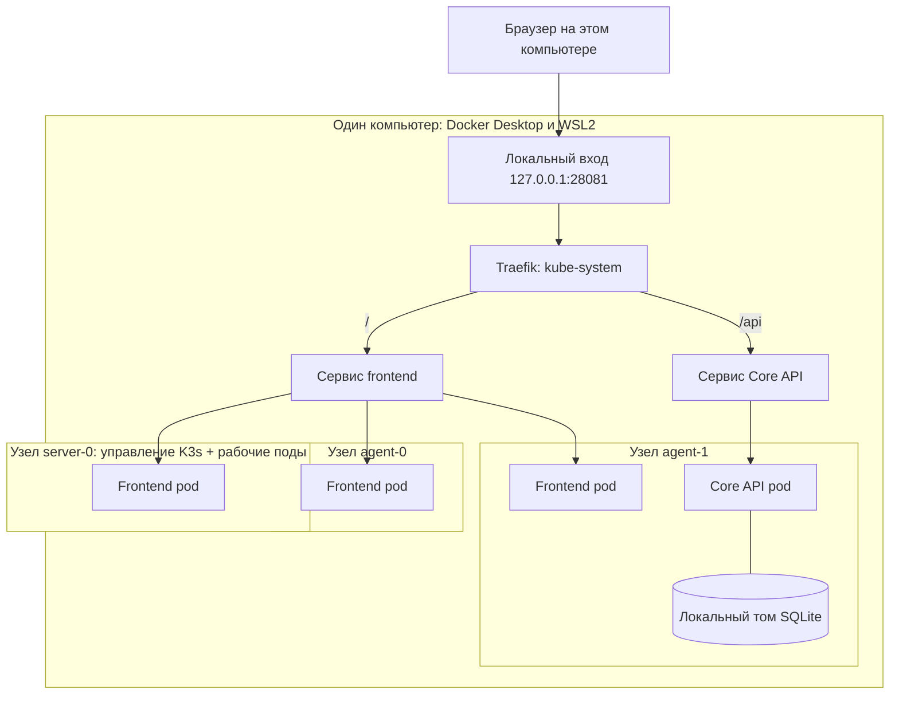
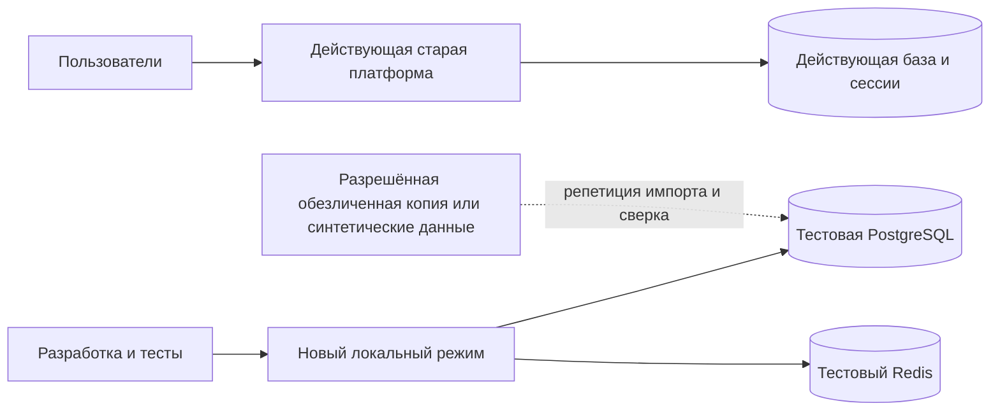
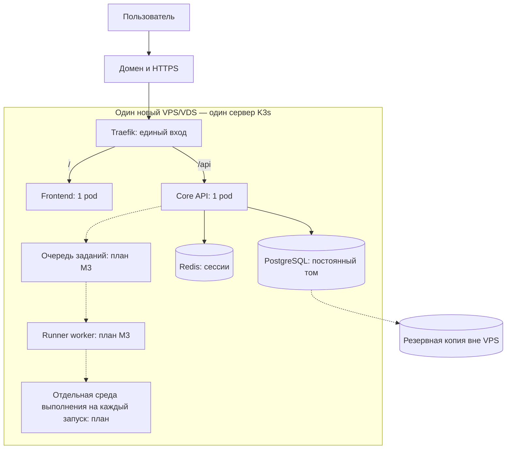
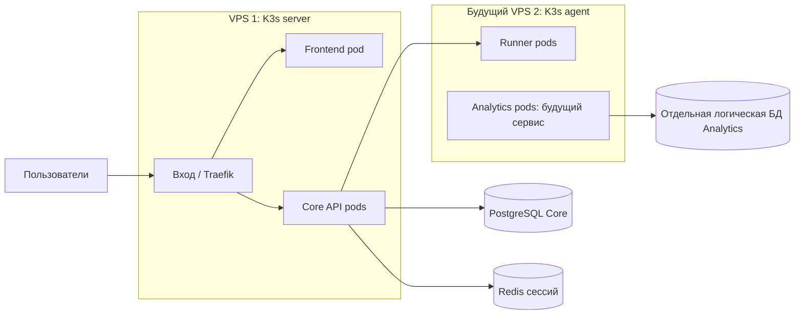

# Core API: схемы размещения и перехода

Схемы описывают план из Jira. Проверенный локальный стенд и будущие решения отмечены отдельно; состояние действующего VPS по этим схемам не определено. Работа над этапами 1–4 локальная, Git и CI/CD не меняются до отдельного решения.

## 1. Локальный k3d: проверено 28 октября 2026

Все три узла ниже — контейнеры k3d внутри одной WSL2 VM на одном компьютере, а не отдельные физические серверы. В проверке были готовы три узла, Core 1/1, frontend 3/3 и PVC SQLite Bound. Размещение подов может измениться после перезапуска.

Проверены страница, каталог, тестовый вход и выход, увеличение frontend с 2 до 3 реплик и сохранение тестовой учётной записи после рестарта Core. Core оставался одной репликой. Это не нагрузочный тест VPS и не доказательство отказоустойчивости между серверами.

## 2. Два режима до конца этапа 4: план

Старая платформа остаётся источником действительных пользовательских данных. Новый режим работает с отдельной базой, Redis, секретами и изолированными внешними эффектами. Не предполагается автоматическая синхронизация или независимая запись обеих версий в одни и те же данные. Перед этапом 5 потребуется проверить процесс финального переноса и восстановления.

## 3. Первый VPS после проверки этапа 5: целевой план

PostgreSQL, Redis и Runner на этой схеме — целевое состояние, а не подтверждение, что они уже работают на VPS. Исполнение пользовательского Python требует отдельно проверенной изоляции. Один VPS остаётся единой точкой отказа. Проверки и переключение выполняются только по задачам C5.1–C5.6 после локального C4.6.

## 4. Возможное дальнейшее расширение: концепция

Добавление agent-ноды увеличивает вычислительные ресурсы, но само по себе не делает управляющий сервер, Traefik или базы отказоустойчивыми. Analytics владеет своими событиями и агрегатами; авторитетный учебный прогресс и доступы остаются в Core. Физическое размещение БД и безопасная передача событий выбираются и проверяются отдельно.

## 5. Этап 5: порядок переключения

1. Принять локальные проверки C4.6; сохранить оба режима.
2. Развернуть новый стек на отдельном VPS с тестовыми данными и адресом, проверить сценарии, нагрузку и восстановление.
3. Сделать и проверить резервные копии; отрепетировать импорт, сверку и финальную дельту.
4. Зафиксировать GO/NO-GO, остановить запись в старый источник на окно переноса, перенести и сверить данные, переключить вход, выполнить smoke и наблюдение.
5. Если после переключения уже возникли новые записи, возврат к старой базе возможен только при проверенном сохранении и переносе этих записей либо восстановлении. Старые копии автоматически не удалять.
